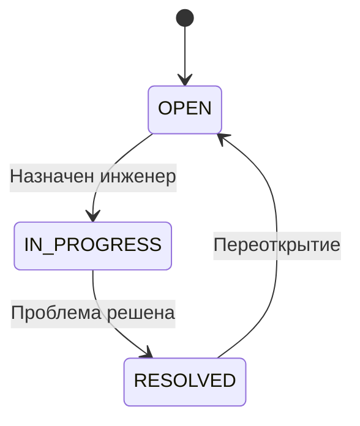

# ServiceDesk Pilot

Небольшой REST API для внутренней IT-поддержки: сотрудник создаёт заявку,
инженер берёт её в работу, оставляет комментарии и отмечает решение.

**Java 17 · Spring Boot 3.5 · Spring Data JPA · PostgreSQL · Flyway · OpenAPI**

## Быстрый запуск

Нужен Docker с Compose:

```bash
git clone https://github.com/Axxelium/ServiceDesk-pilot.git
cd ServiceDesk-pilot
docker compose up --build
```

После запуска:

- [Swagger UI](http://localhost:8080/swagger-ui/index.html) — все запросы можно выполнить из браузера.
- [OpenAPI JSON](http://localhost:8080/v3/api-docs) — описание контракта.
- [Health](http://localhost:8080/actuator/health) — состояние приложения и БД.

Первая сборка скачивает зависимости. База изначально пустая. Данные сохраняются в Docker volume.
Остановка: `docker compose down`.

Это учебный backend без авторизации: имя автора комментария передаётся клиентом и не подтверждает личность.
Compose открывает порты только на localhost. Перед публичным развёртыванием нужны аутентификация,
роли и управление секретами.

## Запуск из IDE / без контейнера приложения

Нужны JDK 17+ и PostgreSQL. Maven устанавливать отдельно не требуется.

```bash
docker compose up -d db
./mvnw spring-boot:run
```

В Windows PowerShell вместо `./mvnw` используйте `.\mvnw.cmd`.
В IntelliJ IDEA откройте `pom.xml` как Maven-проект и запустите `ServiceDeskApplication`.

| Переменная | Значение по умолчанию |
| --- | --- |
| DB_URL | jdbc:postgresql://localhost:5432/servicedesk |
| DB_USER | servicedesk |
| DB_PASSWORD | servicedesk |
| PORT | 8080 |

Пароль по умолчанию предназначен только для локальной демонстрации.
Flyway создаёт схему при старте; Hibernate проверяет её через `ddl-auto=validate`.

## Пример за две минуты

В Swagger выполните запросы по порядку. Подставляйте реальные `id` из ответов.

**1. Создать инженера** — `POST /api/v1/engineers`

```json
{"name":"Dana","email":"dana@example.com"}
```

**2. Создать заявку** — `POST /api/v1/tickets`

```json
{
  "title": "Не подключается VPN",
  "description": "После обновления ноутбука соединение обрывается с ошибкой сертификата.",
  "requesterEmail": "employee@example.com"
}
```

**3. Назначить инженера** — `PUT /api/v1/tickets/1/assignee`

```json
{"engineerId":1}
```

**4. Начать работу** — `PATCH /api/v1/tickets/1/status`

```json
{"status":"IN_PROGRESS"}
```

**5. Оставить комментарий** — `POST /api/v1/tickets/1/comments`

```json
{"author":"Dana","body":"Обновила сертификат VPN, подключение восстановлено."}
```

**6. Закрыть заявку** — `PATCH /api/v1/tickets/1/status`

```json
{"status":"RESOLVED"}
```

Готовый сценарий: [requests.http](requests.http) для HTTP Client в IntelliJ IDEA
или [scripts/demo.ps1](scripts/demo.ps1) для PowerShell:

```powershell
.\scripts\demo.ps1
```

## Правила



- Начальный статус — `OPEN`.
- Нельзя начать работу без инженера или закрыть заявку напрямую из `OPEN`.
- Повтор текущего статуса не меняет заявку.
- В `IN_PROGRESS` инженера можно заменить, но нельзя снять.
- Для смены инженера у решённой заявки сначала нужно её переоткрыть.
- При решении заполняется `resolvedAt`, при переоткрытии очищается; инженер сохраняется.
- Комментарии доступны в любом статусе, возвращаются от старых к новым и не редактируются.
- Email инженера уникален без учёта регистра.
- `@Version` предотвращает потерю изменений при пересекающихся транзакциях.
  Это не проверка устаревших данных клиента: для неё можно добавить `If-Match`/ETag.

## API

Все пути начинаются с `/api/v1`.

| Метод | Путь | Назначение |
| --- | --- | --- |
| POST | /engineers | Создать инженера |
| GET | /engineers | Список инженеров |
| GET | /engineers/{id} | Инженер по ID |
| POST | /tickets | Создать заявку |
| GET | /tickets | Список и фильтры |
| GET | /tickets/{id} | Детали заявки |
| PUT | /tickets/{id}/assignee | Назначить / заменить инженера |
| DELETE | /tickets/{id}/assignee | Снять инженера с открытой заявки |
| PATCH | /tickets/{id}/status | Сменить статус |
| POST | /tickets/{id}/comments | Добавить комментарий |
| GET | /tickets/{id}/comments | История комментариев |

Списки принимают `page` (от 0) и `size` (1–100, по умолчанию 20).
У заявок есть совместимые фильтры `status` и `assigneeId`:

```text
GET /api/v1/tickets?status=IN_PROGRESS&assigneeId=1&page=0&size=10
```

Заявки отсортированы по `createdAt DESC, id DESC`. Ответ списка:
`content`, `page`, `size`, `totalElements`, `totalPages`.

Ошибки возвращаются как `application/problem+json`:
`400` — некорректные входные данные, `404` — ресурс не найден,
`409` — конфликт бизнес-правил или одновременного изменения.

```json
{
  "type": "about:blank",
  "title": "Conflict",
  "status": 409,
  "detail": "Assign an engineer before starting work",
  "instance": "/api/v1/tickets/1/status"
}
```

## Устройство проекта

```text
Controller → DeskService (@Transactional) → Repository → PostgreSQL
                 ↓
        Ticket: правила переходов
```

- Контроллеры отвечают за HTTP и проверку входных DTO.
- Сервис задаёт границы транзакций и собирает ответы.
- Сущность `Ticket` хранит бизнес-правила, поэтому их можно тестировать без Spring.
- `ApiModels` содержит DTO: JPA-сущности не сериализуются в HTTP.
- `ApiExceptionHandler` формирует ошибки без SQL и деталей БД.
- `V1__create_service_desk.sql` задаёт таблицы, внешние ключи, ограничения и индексы.
- `open-in-view=false` исключает скрытые SQL-запросы при сериализации;
  `EntityGraph` загружает инженеров для списка заявок без N+1.

Модель данных: `engineers 1 ← N tickets 1 ← N ticket_comments`.
Исходники намеренно находятся в одном небольшом пакете, без Lombok, микросервисов и лишних слоёв.

## Проверка

```bash
./mvnw verify
```

Тесты запускают **настоящий PostgreSQL** через embedded-postgres, применяют Flyway и проверяют
схему Hibernate. Docker для тестов не нужен; при первой сборке Maven скачивает бинарники БД.
На Linux PostgreSQL нельзя запускать от root. На Windows при ошибке старта
`initdb` может понадобиться Visual C++ 2013 Redistributable x64.

Покрыты переходы статусов, полный HTTP-сценарий, комментарии, фильтрация и пагинация,
валидация, дубликаты email, отсутствующие ресурсы, оптимистическая блокировка, OpenAPI и health.
GitHub Actions запускает эти проверки на Java 17, затем собирает Docker-образ,
поднимает приложение с PostgreSQL 17 и выполняет демонстрацию через настоящий HTTP.

## Что можно развивать дальше

- Spring Security: роли сотрудника, инженера и администратора.
- Приоритеты и SLA, поиск, журнал смены статусов.
- ETag для обнаружения устаревших изменений клиента.
- Уведомления и вложения.

Для разбора решений и подготовки к техническим вопросам: [docs/walkthrough.md](docs/walkthrough.md).

## Документация технологий

- [Spring Boot 3.5](https://docs.spring.io/spring-boot/3.5/)
- [springdoc: совместимость со Spring Boot](https://springdoc.org/v2/)
- [Embedded PostgreSQL для тестов](https://github.com/zonkyio/embedded-postgres)
